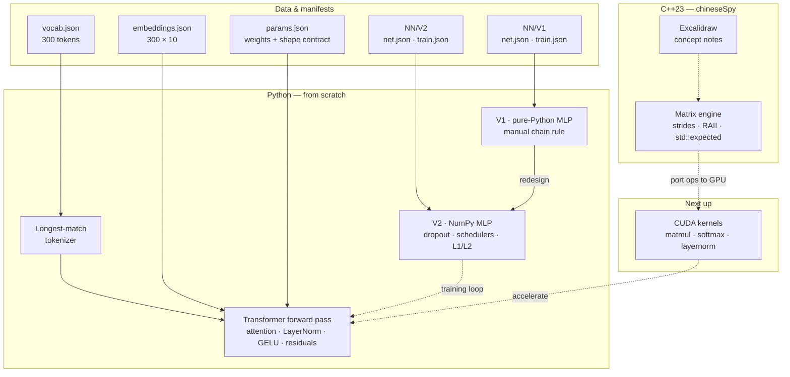

<div align="center">

# 🧠 AIMLDL

### *MorphNet*

**Rebuilding the AI stack from first principles — matrices in C++23, neural networks in pure Python, a transformer in NumPy, and CUDA kernels next.**

[](https://python.org)
[](https://numpy.org)
[](https://en.cppreference.com/w/cpp/23)
[](https://cmake.org)
[](https://github.com/RCZ88/MorphNet)
[](https://github.com/RCZ88/MorphNet)
[](https://github.com/RCZ88/MorphNet)

</div>

---

## 🎯 Why this exists

Most people learn AI by importing it. This repository is the opposite: **every operation is written by hand**, in order, starting from a single `float` in a `std::vector` and ending at a transformer producing logits over a 300-token vocabulary.

The long-term goal isn't a demo. It's **infrastructure** — the backbone layer: tensor math, autograd, kernels, an inference engine, and the serving path around it. Using PyTorch teaches you the API. Rebuilding it teaches you the machine.

Three rules hold across the whole repo:

1. **No training wheels.** No PyTorch, no TensorFlow, no JAX, no autograd library. `numpy` is the only numerical dependency, and the C++ engine doesn't even use that.
2. **Shapes are the source of truth.** Every operation prints its input and output shapes. If the shapes line up, the math is probably right.
3. **Understand it before you optimize it.** The Python versions are deliberately slow and explicit. The C++/CUDA versions come after, and are measured against them.

---

## 📍 Status at a glance

| Track | State | What it demonstrates |
|-------|-------|----------------------|
| **C++23 matrix engine** | 🟢 Builds and runs | A tensor's real layout: contiguous storage, strides, transpose, matmul, RAII, move semantics |
| **Transformer forward pass** | 🟢 Runs end-to-end | Tokenizer → embeddings → 5 pre-LN blocks → tied unembedding → decode |
| **MLP v1 — pure Python** | 🟡 Implemented, loader WIP | Neurons, layers, forward pass and backprop with zero libraries |
| **MLP v2 — NumPy** | 🟡 Implemented, loader WIP | Batched tensors, dropout, LR schedules, L1/L2, config-driven training |
| **Transformer training** | 🔴 Not started | Needs autograd through attention — the next milestone |
| **CUDA kernels** | 🔴 Planned | Matmul, softmax, LayerNorm, fused attention |

> ⚠️ **Everything here is educational.** The weights in `params.json` are hand-written placeholders — the model will produce gibberish on purpose. Correctness is verified by shape contracts and by reproducing known formulas, not by output quality.

---

## ✨ What's inside

| Feature | Description |
|---------|-------------|
| **🧮 Matrix engine from scratch** | C++23 `Matrix` class over a flat `std::vector<float>` with row/column strides, transpose, and multiply/add returning `std::expected` instead of throwing |
| **🔤 Hand-rolled tokenizer** | Longest-match subword tokenizer over a 300-token toy vocabulary; no `tiktoken`, no `sentencepiece` |
| **🎯 Scaled dot-product attention** | `Q = XW_Q`, `K = XW_K`, `V = XW_V`, scores, `1/√d_k` scaling, and an output projection — written out line by line |
| **🧱 Pre-LN transformer block** | LayerNorm → attention → residual → LayerNorm → GELU FFN → residual, stacked 5 deep |
| **📐 Sinusoidal positional encoding** | Generated from the `sin`/`cos` formula at runtime, not loaded from a table |
| **∫ GELU via numerical integration** | The Gaussian CDF is computed with the trapezoid rule over 10,000 points — no `scipy.special.erf` |
| **🔗 Tied unembedding** | `W_vocab = Eᵀ`, so the output projection reuses the token embedding table |
| **📊 Shape-trace logging** | Every matmul prints `(5, 10) @ (10, 3) = (5, 3)`, turning the forward pass into a readable proof |
| **🧠 MLP with manual backprop** | V1 derives gradients by hand; V2 vectorizes them across batches with NumPy |
| **⚙️ Training utilities** | Inverted dropout, step/exponential/cosine LR schedules, linear warmup, L1/L2 regularization, He init |
| **🗂️ JSON-defined models** | Architecture, weights, and datasets live in versioned JSON — inspectable, diffable, no pickles |
| **📝 Concept notebook** | Excalidraw diagrams recording the C++ memory-model and linear-algebra lessons as they were learned |

Two tracks are runnable today: the **transformer forward pass** and the **C++ matrix engine**. The MLP tracks are complete implementations whose JSON loaders are still being wired up — see [Known rough edges](#known-rough-edges).

---

## 🏗️ Architecture



---

## 🔬 The stack, layer by layer

### 1. The math core — `chineseSpy/`

This is where a tensor stops being an abstraction. `Matrix` owns a single contiguous `std::vector<float>` and carries a row stride and a column stride — the same idea PyTorch calls *strides*. Once you've hand-written a transpose and a triple-loop matmul, `torch.matmul` stops being magic.

```cpp
Matrix(int rows, int cols)
    : rows(rows), cols(cols),
      data(rows * cols, 0.0f),
      rowStrides(cols), colStrides(1) {}
```

Two design choices worth studying:

- **Errors are values, not exceptions.** `multiply()` and `add()` return `std::expected<Matrix, std::string>`, so an invalid shape is a compile-time-visible branch rather than a `throw` buried three frames down.
- **Ownership is explicit.** Copy constructor, move constructor, and destructor are all written by hand — the destructor logs every object so you can *see* scope and lifetime in the terminal output.

The default-constructed `Matrix` at the start of `main.cpp` (0×0, next to the heap-allocated ones) is intentional: it's a memory-model exercise, not dead code.

### 2. The neural network — `NN/V1` → `NN/V2`

**V1** is deliberately naive: a `Neuron` holds its own weights and activation, and the training loop walks layers backwards computing derivatives by hand.

**V2** keeps the same structure but rebuilds it around NumPy and modern Python 3.12+ features:

```python
type Vector[T: np.generic] = np.ndarray[tuple[int], np.dtype[T]]
type Matrix[T: np.generic] = np.ndarray[tuple[int, int], np.dtype[T]]
type Tensor3[T: np.generic] = np.ndarray[tuple[int, int, int], np.dtype[T]]
```

The typed tensor aliases, dataclasses with a `__getitem__` mixin, `match`-based config dispatch, and `Enum`-driven schedulers are all part of the exercise — learning to write infrastructure-grade Python, not just scripts.

V2 also introduces the pieces that make training real: **inverted dropout**, **mini-batching with shuffling**, **learning-rate schedules**, and **L1/L2 regularization**:

```python
class CosineDecay(Scheduler):
    def get_lr(self, step):
        return lw_ca(self.start, self.max_, self.final,
                     self.warmup_rounds, self.epoch_amount, step)
```

### 3. The transformer — `NNTOLLM.py`

A single file, read top to bottom, that turns text into tokens and tokens into logits. Nothing is hidden in a library call.

**Tokenization.** Greedy longest-match, descending from 7 characters:

```
"play player playing"
  → ["play", " ", "player", " ", "playing"]
  → token IDs → rows of the embedding table
```

**Attention.** For a sequence of `n` tokens with model width `d_model = 10` and key width `d_k = 3`:

```math
Q = X W_Q,\quad K = X W_K,\quad V = X W_V
```
```math
A = \frac{QK^\top}{\sqrt{d_k}},\qquad \text{out} = A V W_O
```

> The textbook applies `softmax` to `A` before multiplying by `V`. The current code stops at scaling — applying softmax is on the fix list, and that gap is itself a useful lesson in why the softmax exists.

**The block.** Pre-normalization, residuals, and a GELU feed-forward network:

```math
X' = X + \mathrm{Attn}(\mathrm{LN}(X))
```
```math
X'' = X' + W_2\,\mathrm{GELU}(W_1\,\mathrm{LN}(X') + b_1) + b_2
```

`GELU(x) = x · Φ(x)` is computed by numerically integrating the standard normal PDF — slow, but it makes the definition of `Φ` concrete instead of magic.

**Output.** The final hidden state is projected back into vocabulary space using the *transposed embedding matrix* (`W_vocab = Eᵀ`), scaled by temperature, softmaxed, and argmaxed:

```math
\mathrm{logits} = X_{\text{final}} E^\top \in \mathbb{R}^{n \times 300}
```

Because the model is untrained, the decode step returns real token IDs with no linguistic meaning. That's expected.

**What the run actually looks like.** The shape trace is the documentation:

```text
'X = combineXs(rt)' SHAPE: (5, 10)
'K = X @ W_K' SHAPE: (5, 10) @ (10, 3) = (5, 3)
'Q = X @ W_Q' SHAPE: (5, 10) @ (10, 3) = (5, 3)
'S = Q @ K_T' SHAPE: (5, 3) @ (3, 5) = (5, 5)
'A = S.copy() / math.sqrt(d_k)' SHAPE: (5, 5) / scalar = (5, 5)
'O_head = A @ V' SHAPE: (5, 5) @ (10, 3) = (5, 3)
'O_projection = attn_out @ W_O' SHAPE: (5, 3) @ (3, 10) = (5, 10)
'X_projection = X + O_projection' SHAPE: (5, 10) + (5, 10) = (5, 10)
'X_l = X_projection + FFN' SHAPE: (5, 10) + (5, 10) = (5, 10)
'logits = X @ W_vocab' SHAPE: (5, 10) @ (10, 300) = (5, 300)
```

### 4. The data contracts — `vocab.json`, `embeddings.json`, `params.json`

The JSON files aren't just weights; they're a **specification**. `params.json` declares every intermediate shape the model must produce:

```json
"expected_intermediate_shapes": {
  "X": [3, 10],
  "Q": [3, 3],
  "scores": [3, 3],
  "attention": [3, 3],
  "attention_output": [3, 10],
  "ff_output": [3, 10],
  "logits": [3, 300]
}
```

alongside a `validation_checks` list and an explicit note about which earlier 12-token toy model it supersedes. This is the habit that makes the C++ and CUDA rewrites verifiable: **the contract is written down before the kernel exists.**

| Artifact | Shape | Purpose |
|----------|-------|---------|
| `vocab.json` | 300 tokens | Token ↔ ID map, special tokens `PAD=0`, `UNK=1`, `BOS=2`, `EOS=3` |
| `embeddings.json` | `300 × 10` | Token embedding table `E` (placeholder values) |
| `params.json` | — | Architecture, weights, normalization params, shape manifest |

---

## 🚀 Quick start

### Prerequisites

| Tool | Version used | Notes |
|------|--------------|-------|
| Python | 3.14 (3.12+ required) | V2 uses PEP 695 `type` statements |
| NumPy | latest | Only Python dependency for the transformer |
| C++ compiler | GCC 16 (C++23) | Needs `std::expected` |
| CMake | 4.3+ | Required by `CMakeLists.txt` |

### 1. Clone and create an environment

```bash
git clone https://github.com/RCZ88/MorphNet.git
cd MorphNet

python3 -m venv .venv
source .venv/bin/activate
pip install numpy
```

> ℹ️ `NNTOLLM.py` currently has an unused `from transformers import GPT2LMHeadModel` at the top. Either comment it out or `pip install transformers` — nothing from the library is used yet.

### 2. Run the transformer

**Run from the repository root** — all model artifacts are loaded by relative path.

```bash
python NNTOLLM.py
```

```text
Input Something: play player playing
```

You'll get a tokenization dump, a few dozen shape lines, and a short string of decoded token IDs.

### 3. Build the C++ matrix engine

```bash
cmake -S . -B build -DCMAKE_BUILD_TYPE=Debug
cmake --build build
./build/AIMLDL     # matrix / memory-model exercise
./build/INTRO      # language fundamentals sandbox
```

### 4. The MLP tracks

The MLP modules (`NN/V1`, `NN/V2`) are **reference implementations**, not runnable trainers yet: V1's loader still expects the older list-shaped `net.json`, and V2 imports a NumPy example module that needs `cffi` and doesn't expose the RNG it expects. Both are small, contained fixes — tracked in [Known rough edges](#known-rough-edges).

---

## 📁 Project structure

```text
AIMLDL/
├── chineseSpy/                  # C++23 math core & language sandbox
│   ├── Matrix.hpp / Matrix.cpp  # Tensor storage, strides, transpose, matmul, add
│   ├── main.cpp                 # RAII, heap vs stack, move semantics exercise
│   ├── intro.cpp                # C++ fundamentals scratchpad
│   └── Excalidraw/              # Hand-drawn concept notes (cppLEMON.excalidraw.md)
│
├── NN/
│   ├── V1/                      # Pure-Python MLP — no NumPy
│   │   ├── NN_lib.py            # Neuron & Layer primitives
│   │   ├── S1.py                # Forward/backward, sigmoid, He/Xavier init
│   │   ├── net.json             # Topology + neuron state
│   │   └── train.json           # Toy dataset
│   └── V2/                      # NumPy MLP redesign
│       ├── S2.py                # Typed tensors, dropout, schedulers, L1/L2
│       ├── net.json
│       └── train.json
│
├── NNTOLLM.py                   # Full transformer forward pass, shape-by-shape
├── params.json                  # Weight + shape contract for the transformer
├── embeddings.json              # 300 × 10 token embeddings
├── vocab.json                   # 300-token longest-match vocabulary
├── main.py                      # PyCharm scaffold (unused)
└── CMakeLists.txt               # Builds AIMLDL and INTRO
```

---

## 🛠️ Tech stack

| Layer | Technology | Why |
|-------|-----------|-----|
| **Math / memory** | C++23, `std::expected`, `std::vector` | Manual control over layout, lifetime, and error paths |
| **Numerics** | NumPy (only) | Vectorized ops without hiding the math |
| **Transformer** | Hand-written NumPy forward pass | Every tensor, every reshape, in one file |
| **MLP v1** | Pure Python | Gradients derived and applied by hand |
| **Config** | JSON manifests | Diffable, inspectable, no serialization magic |
| **Build** | CMake 4.3, GCC 16 | C++23 features with strict standard enforcement |
| **Notebook** | Excalidraw | Concepts recorded visually as they're learned |
| **Next** | CUDA | Kernel-level implementation of the same operations |

---

## 🧠 CS topics covered

| Concept | Where it lives |
|---------|----------------|
| **Linear algebra from scratch** | `Matrix` matmul, transpose, and stride arithmetic |
| **Memory layout & cache behavior** | Contiguous `std::vector<float>` with row/column strides |
| **RAII, copy/move semantics** | Hand-written constructors and destructors in `Matrix.cpp` |
| **Error-as-value design** | `std::expected<Matrix, std::string>` throughout the engine |
| **Scaled dot-product attention** | `softmax(QKᵀ/√d_k)V` with learned projections |
| **Transformer architecture** | Pre-LN blocks, residual streams, stacked depth |
| **Layer normalization** | Per-token mean/variance with affine `γ`, `β` |
| **GELU & the Gaussian CDF** | Numerically integrated normal PDF, no `erf` |
| **Sinusoidal positional encoding** | `sin`/`cos` at geometrically spaced frequencies |
| **Weight tying** | Output projection `W_vocab = Eᵀ` |
| **Softmax & temperature decoding** | Greedy argmax over temperature-scaled logits |
| **Longest-match tokenization** | 7-character greedy subword segmentation |
| **Backpropagation** | Manual chain rule and sigmoid derivative in V1 |
| **Weight initialization** | Glorot/Xavier bounds, fan-in scaling |
| **LR scheduling** | Step, exponential, cosine annealing with warmup |
| **Regularization** | Inverted dropout, L1, L2 |
| **Mini-batch SGD** | Shuffled batches, gradient accumulation over `m` samples |
| **Numerical methods** | Trapezoidal integration for the normal CDF |

---

## 🗺️ Roadmap

The destination is a complete, self-hosted AI stack — not a model, the machinery underneath it.

- ✅ **Phase 0 — Math core.** Matrix storage, strides, transpose, matmul, error handling in C++23. *(Builds and runs; a couple of layout bugs to fix.)*
- ✅ **Phase 1 — Forward pass.** Tokenizer → embeddings → attention → FFN → logits, in NumPy. *(Runs end-to-end; attention softmax and the final projection are pending — see rough edges.)*
- 🟡 **Phase 2 — Networks from scratch.** MLP forward/backward without frameworks; vectorized redesign in V2. *(Code written, loaders not yet runnable.)*
- ⬜ **Phase 3 — Autograd.** Reverse-mode differentiation through attention, LayerNorm, GELU, and softmax. Train the transformer for real.
- ⬜ **Phase 4 — Tokenizer & data pipeline.** Byte-pair encoding, dataset streaming, reproducible batching.
- ⬜ **Phase 5 — CUDA kernels.** Tiled matmul, warp-level softmax, fused LayerNorm, FlashAttention-style blocked attention. Benchmark against NumPy at every step.
- ⬜ **Phase 6 — Inference engine.** KV cache, quantization (int8/fp16), continuous batching, sampling strategies.
- ⬜ **Phase 7 — Serving infrastructure.** C ABI, request scheduler, metrics, tracing, and a benchmark harness.
- ⬜ **Phase 8 — Scale-out.** Multi-GPU tensor parallelism and a reproducible training run.

---

## 🧭 Suggested reading order

If you're learning alongside this repo, read the files in this order — each one adds exactly one new idea:

1. **`chineseSpy/Matrix.hpp` → `Matrix.cpp`** — what a tensor physically is.
2. **`NN/V1/NN_lib.py` → `S1.py`** — what a neuron is, and what a gradient is.
3. **`NN/V2/S2.py`** — how the same thing looks when it's vectorized and configurable.
4. **`params.json`** — the shape contract that ties everything together.
5. **`NNTOLLM.py`** — the same primitives, composed into a transformer.
6. **`chineseSpy/Excalidraw/`** — the reasoning behind the C++ decisions, drawn out.

---

## ⚠️ Known rough edges

<a id="known-rough-edges"></a>

This is a lab notebook, not a release. Current state, honestly:

| Area | What to know |
|------|--------------|
| **Transformer decode** | Logits are projected from the *embedding* matrix `X` rather than the block output `X_final` — the 5-block stack is currently computed but unused in the final projection |
| **Attention** | Scores are scaled by `1/√d_k` but **softmax is not applied** before multiplying by `V`; the `softmax()` helper is also broken (indexes an empty list) and unused |
| **Positional encoding** | The frequency term is indexed by dimension `j` instead of position `i`, so it doesn't vary across tokens |
| **Activation mismatch** | `params.json` declares `"activation": "relu"`, but the block implements `GELU` |
| **V1 initialization** | `he_init()` uses `√(6/fan_in)` — that's the Glorot/Xavier bound; true He init is `√(2/fan_in)` |
| **V1 weight update** | The update rule uses `(a_prev − δ)` rather than `a_prev · δ`; it's a first-pass derivation, not a correct gradient step |
| **V1 loader** | `loadDatas()` iterates the top-level `net.json` object as if it were the layer list; the file is now `{shape, layers, ...}` |
| **V2 imports** | `rng` is imported from `numpy.random._examples.cffi.extending`, which requires `cffi` and doesn't define an RNG — should be `np.random.default_rng()` |
| **V2 scheduler** | `lw_ca()` branches backwards — warmup triggers when `t > warmup` |
| **V2 data loader** | `inputs` / `evals` tensors are populated before allocation; `run()` isn't wired up yet |
| **C++ matrix copies** | The copy constructor doesn't copy `data`, so copies come back zero-filled |
| **C++ transpose** | `transform()` writes using the *source* strides and never swaps them, so non-square transposes mis-index |
| **Weights** | All transformer matrices are hand-authored placeholders. Output is meaningless by construction. |

Fixing these is the work of Phase 3, and each one is a lesson in why the reference implementations look the way they do.

---

## 🤝 Contributing

This is a personal learning repository, so it isn't accepting feature PRs — but issues pointing out a wrong derivation, a broken shape, or a better way to explain something are genuinely welcome. If you're building something similar, fork it and make it yours.

## 📄 License

No license file yet. Until one is added, treat the code as **all rights reserved**. If this becomes something you want others to build on, MIT or Apache-2.0 are the usual choices for this kind of project.

## 🙏 Acknowledgments

- The transformer architecture: Vaswani et al., *Attention Is All You Need* (2017)
- LayerNorm: Ba, Kiros & Hinton (2016); GELU: Hendrycks & Gimpel (2016)
- `std::expected` for making shape errors part of the type signature
- Excalidraw for the notes that survived the learning process

---

<div align="center">

**Built from scratch, on purpose.**

[Repository](https://github.com/RCZ88/MorphNet) · [Report an Issue](https://github.com/RCZ88/MorphNet/issues)

<sub>If the shapes line up, the math is probably right.</sub>

</div>
